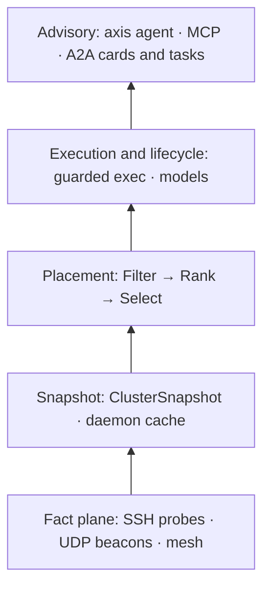

<p align="center">
  <picture>
    <source media="(prefers-color-scheme: dark)" srcset="docs/assets/axis-banner-dark.png">
    <source media="(prefers-color-scheme: light)" srcset="docs/assets/axis-banner-light.png">
    
  </picture>
</p>

<p align="center">
  <strong>Local-first, reservation-aware cluster substrate.</strong><br>
  AXIS reads real hardware facts from machines you already own, then tells you (and your agents) where work fits.
</p>

<p align="center">
  <a href="https://github.com/toasterbook88/Axis/releases/latest"></a>
  <a href="https://github.com/toasterbook88/Axis/actions/workflows/ci.yml"></a>
  <a href="LICENSE"></a>
</p>

## Quick start

Install to `~/.local/bin` (no `sudo`), then check the binary. macOS and Linux only.

```bash
curl -fsSL https://raw.githubusercontent.com/toasterbook88/axis/main/install.sh \
  | AXIS_VERSION=v0.19.6 AXIS_REQUIRE_PINNED=1 \
    AXIS_INSTALL_DIR="$HOME/.local/bin" bash
```

```bash
export PATH="$HOME/.local/bin:$PATH"
axis version
```

Describe your machines. `axis init` is interactive, so run it on its own and answer the prompts. It writes `~/.axis/nodes.yaml`.

```bash
axis init
```

See the cluster and ask where a job would fit. Placement is advisory: nothing runs.

```bash
axis cluster status
axis task place "run ollama inference on a 7b model"
```

<details>
<summary>Example output (one-node cluster)</summary>

```text
CLUSTER STATUS (1 nodes, 1 healthy)

      NAME                 STATUS     ARCH      RAM TOTAL   RAM FREE PRESSURE  GPUS
  ─────────────────────────────────────────────────────────────────────────────────────
  ● local (local)        complete   amd64       16002MB     3674MB      low

Snapshot: live sweep | age 0s
```

When no node qualifies, `axis task place` says why and exits with code 3:

```text
✗ No suitable node found.
  - 0 of 1 nodes qualify
  - workload class: local-llm-inference
  -   local: need 4096MB free RAM, have 3658MB allocatable (free 3658MB, short 438MB)
```

</details>

## What it does

AXIS collects facts over SSH (plus optional UDP beacons), builds a deterministic cluster snapshot, and makes **reservation-aware placement decisions**. Optional surfaces add guarded execution, resident-model lifecycle, a local HTTP API, MCP, and an A2A agent card and task plane.



Each layer is subordinate to the one below it. Advisory surfaces never override observed state.

> **Truth boundary:** no generated output may present itself as cluster truth unless a real snapshot or live probe backs it.

| You need | AXIS does |
| --- | --- |
| Honest placement | Filter → Rank → Select on a real `ClusterSnapshot` |
| Shared RAM accounting | Soft reservations overlaid on live and cached reads |
| Safe execution | Safety gates, then reserve → run → release |
| Local operation | API on `~/.axis/axis.sock`; state under `~/.axis/` |

## Requirements

| | |
| --- | --- |
| Platforms | macOS and Linux, amd64 and arm64. **Windows is not supported.** |
| Installer | `bash`, `curl`, and `sha256sum` or `shasum` |
| Cluster | Key-based SSH from this machine to every node in `nodes.yaml` |
| Source builds | Go 1.26.9 or newer and `make`. Go 1.21+ downloads 1.26.9 itself unless `GOTOOLCHAIN=local` is set. |

## Install

> [!IMPORTANT]
> Use v0.19.6 or later. Git history was rewritten on 2026-10-12, and v0.9.0 through v0.19.5 are retracted in `go.mod`.

The [Quick start](#quick-start) command is the recommended install. Other options:

<details>
<summary>System-wide install to <code>/usr/local/bin</code> (uses <code>sudo</code>)</summary>

```bash
curl -fsSL https://raw.githubusercontent.com/toasterbook88/axis/main/install.sh \
  | AXIS_VERSION=v0.19.6 AXIS_REQUIRE_PINNED=1 bash
```

A system install may remove verified user-local AXIS copies so only one `axis` is on `PATH`. Set `AXIS_KEEP_LEGACY=1` to keep them.

</details>

<details>
<summary>Build from source</summary>

```bash
git clone https://github.com/toasterbook88/axis.git
cd axis
make build
make install-user
```

`make install-user` copies the binary to `~/.local/bin/axis`.

</details>

<details>
<summary>Install with <code>go install</code></summary>

```bash
go install github.com/toasterbook88/axis/cmd/axis@latest
```

The binary lands in `$(go env GOPATH)/bin`. Builds made this way don't record a commit in `axis version`.

</details>

<details>
<summary>Installer options</summary>

| Variable | Default | Effect |
| --- | --- | --- |
| `AXIS_VERSION` | `latest` | Release tag to install |
| `AXIS_REQUIRE_PINNED` | `0` | `1` refuses `latest` |
| `AXIS_INSTALL_DIR` | `/usr/local/bin` | Target directory |
| `AXIS_DRY_RUN` | `0` | `1` prints the plan and writes nothing |
| `AXIS_KEEP_LEGACY` | `0` | `1` leaves other AXIS copies in place |
| `AXIS_FORCE_REPLACE` | `0` | `1` overwrites a non-AXIS file at the target |

Preview an install without writing anything:

```bash
curl -fsSL https://raw.githubusercontent.com/toasterbook88/axis/main/install.sh \
  | AXIS_DRY_RUN=1 AXIS_VERSION=v0.19.6 bash
```

</details>

<details>
<summary>Verify a release archive yourself</summary>

The installer already checks `checksums.txt`. Release archives also carry GitHub build-provenance attestations. With GitHub CLI 2.49 or newer:

```bash
gh attestation verify axis_0.19.6_linux_amd64.tar.gz --repo toasterbook88/Axis
```

</details>

## Usage

### Status and placement

```bash
axis node facts
axis doctor
axis cluster status --live
axis placement explain "run ollama inference on a 7b model"
```

`axis cluster status` reads the daemon's cached snapshot when it is under 5 minutes old and prints its source and age. `--live` forces a fresh sweep; `--cached-only` fails instead of sweeping. `axis task run` is the separate command that actually executes work, behind safety gates.

### Local API and daemon

`axis serve` runs in the foreground on the Unix socket `~/.axis/axis.sock`. It is the same listener as `axis daemon start`.

```bash
axis serve
```

In a second terminal. `/health` and the agent card need no token; `localhost` here is only a placeholder curl needs for `--unix-socket`:

```bash
curl -fsS --unix-socket "$HOME/.axis/axis.sock" \
  http://localhost/health
curl -fsS --unix-socket "$HOME/.axis/axis.sock" \
  http://localhost/.well-known/agent-card.json
```

Other routes (`/snapshot`, `/run`, `/a2a/v1/...`) need `Authorization: Bearer` with the token in `~/.axis/token`. The agent card advertises `streaming: false`: synchronous send and get only.

To run the daemon as a launchd or systemd user service instead:

```bash
axis daemon service install
axis daemon status
```

### Commands

<details>
<summary>Stable operator commands</summary>

| Command | Purpose |
| --- | --- |
| `axis version` | Build version, commit, Go version |
| `axis init` | Interactive cluster configuration (`--config` overrides `~/.axis/nodes.yaml`) |
| `axis node facts` | This machine (`axis facts` is the same command) |
| `axis cluster status` | Cached snapshot under 5 minutes old; `--live` sweeps; `--cached-only` fails closed |
| `axis task place` | Advisory placement (`--format text\|json`) |
| `axis placement explain` | Per-node ranking explanation |
| `axis task run` | Guarded execution with safety gates |
| `axis task delegate\|status\|approve\|reject` | A2A task lifecycle |
| `axis model` | `plan`, `start`, `await`, `query`, `stop`, `list`, `inspect`, `catalog`, `evict`, `resume` |
| `axis reservations` | `list`, `inspect`, `release`, `doctor` |
| `axis doctor` | Config, SSH, daemon ownership, local AI backends (`--strict`) |
| `axis daemon` | `status`, `refresh`, `invalidate`, `restart`, `service install\|status\|uninstall` |
| `axis serve` | Local HTTP API (foreground; Unix socket by default) |
| `axis mesh` | Gossip mesh diagnostics: `status`, `peers` |
| `axis tui` | Full-screen cluster dashboard |
| `axis update` | Self-update from GitHub Releases |

On an interactive terminal, bare `axis` opens `axis agent`; piped or scripted, it prints help.

</details>

<details>
<summary>Experimental and advisory commands</summary>

| Command | Purpose |
| --- | --- |
| `axis mcp serve` | Read-only MCP server over stdio |
| `axis mcp client` | MCP client (`list`, `tools`, `call`, …) |
| `axis agent` | Tool-calling agent loop, subordinate to observed facts |
| `axis ai` / `axis cortex` | Inference routing and vector-memory helpers |

`axis chat` and `axis llm` were removed. Use `axis agent` and `axis ai route`.

</details>

Full command notes: [`docs/current-state.md`](docs/current-state.md).

## Security

> [!WARNING]
> The daemon joins a UDP gossip mesh on port 42426 unless `nodes.yaml` disables it. Without `discovery.secret`, gossip accepts unsigned messages from any peer that can reach that port.

- Set a shared secret on every node, or set `enabled: false` to turn discovery and the mesh off:

  ```yaml
  discovery:
    enabled: true
    secret: "replace-with-a-long-random-string"
  ```

- Allow UDP 42424 (beacons) and 42426 (gossip) only from your own network or VPN.
- Keep the API on the Unix socket. If you pass `axis serve --addr`, bind to `127.0.0.1`.
- A2A task commands refuse non-loopback `--addr` targets unless `AXIS_ALLOW_OFFBOX_BEARER=1` is set. Configured remote-node names bypass that check and attach the local token. Until a cross-node auth model exists, use the target host's local Unix socket. See the [token boundaries](docs/authority-secrets.md).
- `~/.axis/token` is the API credential. Don't commit or share it.

Report vulnerabilities privately: see [`SECURITY.md`](SECURITY.md). Secret handling rules: [`docs/authority-secrets.md`](docs/authority-secrets.md).

## Update, roll back, uninstall

```bash
axis update --check
axis update
```

`axis update --all` also updates other validated AXIS copies on `PATH` and in common install locations.

To roll back, re-run the installer with the tag you want. It replaces an existing AXIS binary in place:

```bash
curl -fsSL https://raw.githubusercontent.com/toasterbook88/axis/main/install.sh \
  | AXIS_VERSION=v0.19.6 AXIS_REQUIRE_PINNED=1 \
    AXIS_INSTALL_DIR="$HOME/.local/bin" bash
```

<details>
<summary>Uninstall</summary>

Stop the user service, then remove the binary. The last command also deletes your config and API token.

```bash
axis daemon service uninstall
rm "$HOME/.local/bin/axis"
rm -rf "$HOME/.axis"
```

For a system-wide install, remove `/usr/local/bin/axis` with `sudo` instead.

</details>

## Documentation

| Doc | Contents |
| --- | --- |
| [`docs/current-state.md`](docs/current-state.md) | Live product truth (trust this over older specs) |
| [`docs/operator-quickstart.md`](docs/operator-quickstart.md) | Longer operator onboarding |
| [`docs/architecture.md`](docs/architecture.md) | Layered architecture reference |
| [`docs/daemon-service.md`](docs/daemon-service.md) | launchd and systemd user service |
| [`docs/troubleshooting.md`](docs/troubleshooting.md) | Common failures and fixes |
| [`nodes.example.yaml`](nodes.example.yaml) | Annotated cluster config |
| [`docs/`](docs/) | Authority contracts (`authority-*.md`: reservation, secrets, execution, …) |
| [`CHANGELOG.md`](CHANGELOG.md) | Release history |

## Status

| Item | Value |
| --- | --- |
| Latest release | [**v0.19.6**](https://github.com/toasterbook88/axis/releases/tag/v0.19.6) (tag commit `990a836`) |
| Supported security line | `v0.19.x` (see [`SECURITY.md`](SECURITY.md)) |
| Release builds | darwin and linux × amd64 and arm64 (reproducible GoReleaser builds) |

## Build and test

```bash
make build
make test
```

| Target | What it does |
| --- | --- |
| `make build` | `CGO_ENABLED=0 go build -trimpath -o axis ./cmd/axis/` |
| `make install-user` | Installs to `~/.local/bin/axis` |
| `make install-system` | Installs to `/usr/local/bin/axis` (needs `sudo`) |
| `make test` | Hermetic `go test ./...` plus docs tool tests |
| `make test-race` | Tests with the race detector |
| `make lint` | gofmt, go vet, staticcheck |
| `make coverage` | `hack/coverage-check.sh` |

## Contributing

See [`CONTRIBUTING.md`](CONTRIBUTING.md). `main` is protected: required CI checks and squash-only merges. AI agents: read [`AGENTS.md`](AGENTS.md) first.

## License

[MIT](LICENSE). Copyright © 2026 **Smith Software Solutions**.

---

<p align="center">
  <a href="https://axismcp.app">axismcp.app</a> ·
  <a href="https://axismcp.tech">axismcp.tech</a> ·
  <a href="https://smithsolutionssc.com">smithsolutionssc.com</a> ·
  <a href="https://x.com/AXISBRIDGEMACOS">@AXISBRIDGEMACOS on X</a>
</p>
